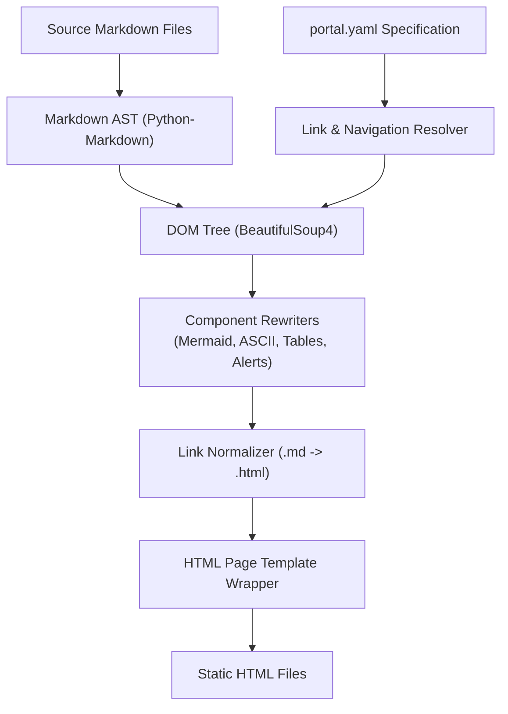

# Internal Architecture & AST Compilation Pipeline

`research-portal-studio` implements a multi-stage Abstract Syntax Tree (AST) compilation and transformation pipeline.

---

## 1. Pipeline Overview

---

## 2. Compilation Stages

### Stage 1: Frontmatter Stripping & Alert Pre-Processing
- Removes YAML frontmatter delimiters (`--- ... ---`) from the top of markdown documents to prevent raw metadata leaking into body copy.
- Parses GitHub Alert syntax (`> [!NOTE]`, `> [!WARNING]`, etc.) into pure grayscale semantic callout tags before Markdown parsing.

### Stage 2: Markdown AST Generation
Utilizes `markdown` with the following extension set:
- `tables`: Standard GFM pipe table parser.
- `fenced_code`: Triple-backtick block demarcation.
- `toc`: Header inspection and anchor calculation.
- `nl2br`: Conservative whitespace preservation.
- `codehilite`: Code element tagging.

### Stage 3: DOM Tree Rewriting (BeautifulSoup4)
The raw HTML AST is converted to a mutable DOM tree:
1. **Tables**: Wrapped in `
` and assigned the `.data-table` class to support horizontal scrolling on mobile viewports.
2. **Mermaid Diagrams**: Detected by code class or keyword header (`flowchart`, `graph`, `sequenceDiagram`). Rewritten into `

...

`.
3. **ASCII Box Schematics**: Monospace code blocks containing UTF-8 box-drawing characters (`┌`, `─`, `│`, `└`) or tagged `ascii`/`text` are wrapped into `
<pre><code class="ascii-art">...</code></pre>
`.

### Stage 4: Cross-Document Link Normalization
All `<a>` tags with relative Markdown destinations (`href="../path/to/doc.md#anchor"`) are inspected against the resolved page map. Relative file paths are swapped for the target `.html` filename while preserving hash anchors.

### Stage 5: Template Assembly
The transformed DOM is injected into the single-page HTML skeleton:
- Injects responsive breadcrumb path.
- Generates categorized sidebar navigation with active page indicators.
- Emits sequential previous/next pagination footer controls.
