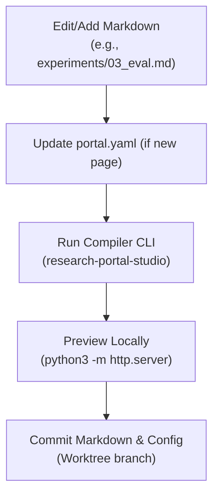

# Human Operator Workflow & Maintenance Guide

This guide establishes the operating protocol for maintaining and updating research portals without encountering the "harness tax" or manual HTML divergence.

---

## 1. Golden Rules of Portal Maintenance

1. **Markdown is the Single Source of Truth**: Human operators and researchers author exclusively in Markdown. Never edit generated `.html` files in the output directory.
2. **Deterministic Regeneration**: Any change in Markdown or assets is compiled via a single CLI invocation. The compiler guarantees consistent AST parsing and component wrapping.
3. **Pure Grayscale Consistency**: Visual aesthetics must strictly adhere to the Pure Grayscale Design System ($R=G=B$). Do not inject inline colored styles or chromatic color classes.

---

## 2. Standard Authoring Cycle



### Step 1: Writing Markdown Content
Structure empirical and analytical documents with the standard 6-part scientific research canon:
- `## 1. Problem Definition & Motivation`
- `## 2. Research Questions & Objectives`
- `## 3. Baseline & Prior State Analysis`
- `## 4. Experimental Methodology & Architecture`
- `## 5. Empirical Results & Measurements`
- `## 6. Analysis & Synthesis`

### Step 2: Utilizing Native Grayscale Components
The compiler automatically translates native Markdown formatting into design system components:
- **Alerts & Callouts**:
  ```markdown
  > [!NOTE]
  > This is a neutral technical callout.

  > [!WARNING]
  > This boundary condition requires a dedicated fallback gate.
  ```
- **Mermaid Flowcharts**:
  ````markdown
  ```mermaid
  flowchart LR
    A[Raw Context] --> B[System-1 Gate]
    B --> C[System-2 Reasoner]
  ```
  ````
- **ASCII Schematics**:
  ````markdown
  ```text
  ┌───────────────┐     ┌───────────────┐
  │ Host Memory   │ ──> │ dGPU (VRAM)   │
  └───────────────┘     └───────────────┘
  ```
  ````
- **Data Tables**:
  ```markdown
  | Model | Memory (VRAM) | Latency (ms) | Accuracy |
  |---|---|---|---|
  | Laya-v4b | 0 MB (CPU) | 8.4 ms | 88.2% |
  | D1-3B | 0 MB (CPU) | 12.1 ms | 87.5% |
  ```

### Step 3: Compile the Portal
Execute the compiler against your source repository:
```bash
research-portal-studio --source . --output ./portal --config portal.yaml
```

### Step 4: Validate Changes
Start a temporary HTTP server:
```bash
python3 -m http.server 8080 --directory ./portal
```
Inspect the compiled page in your browser. Verify:
- Navigation sidebar displays the new entry.
- Links between documents resolve to `.html` destinations without 404 errors.
- Visual components render within their respective grayscale frames.
